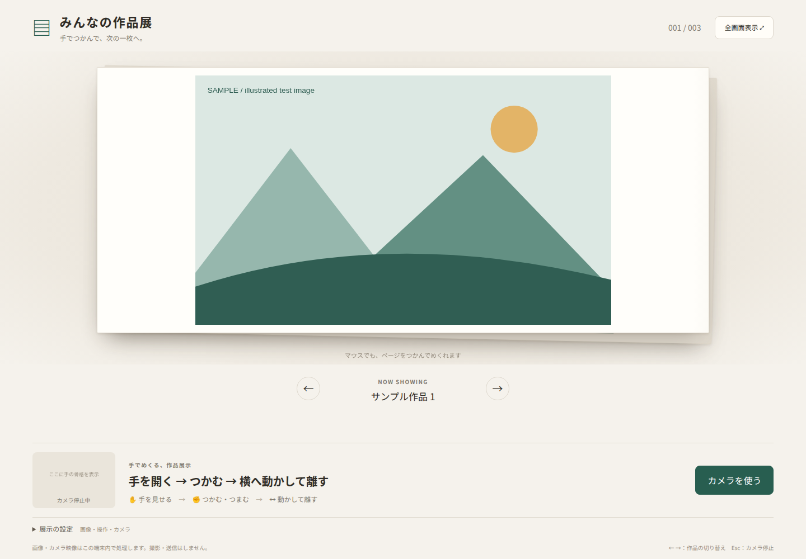
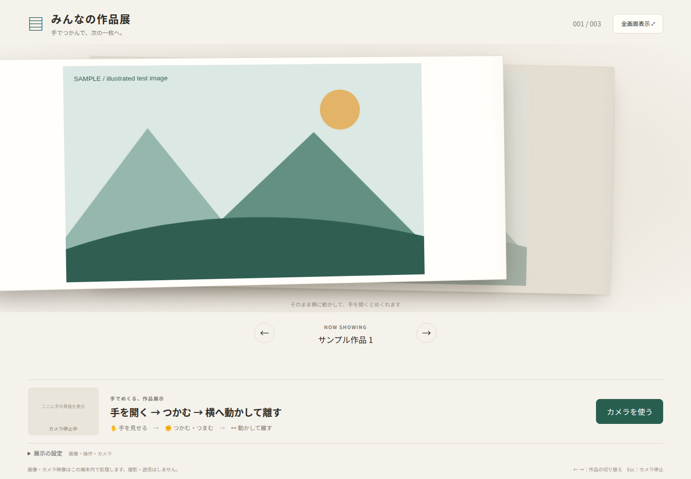
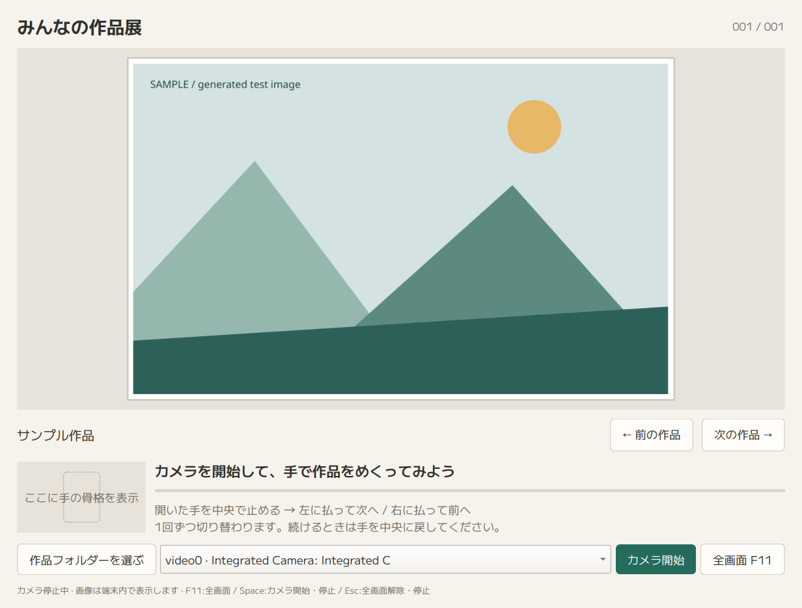
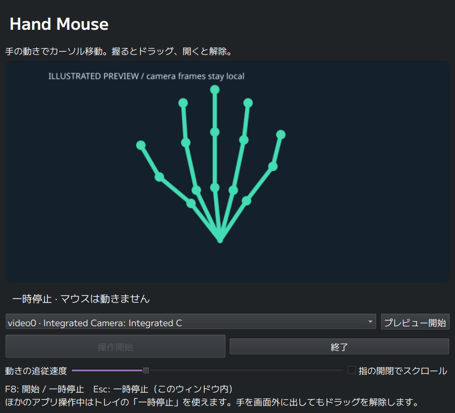

# Hand Gallery / Hand Mouse

## HTML版：つかんでめくる作品展

文化祭などの作品展示に向けたブラウザー版です。手を開いて見せてから、**手を握るか、親指と人差し指でつまんでページをつかみ、横に動かして離す**と作品がめくれます。中央へ手を合わせたり、素早く払ったりする必要はありません。





*画面例の作品は説明用の図形です。利用者の写真をスクリーンショットやリポジトリに含めていません。*

### 起動

Node.js / npm と Python（uv）を使用します。手の認識・ジェスチャ判定・描画はHTML / CSS / JavaScriptで実行し、Pythonはローカル画像と必要なファイルを配信します。Qtや仮想マウスは使用しません。

```bash
cd ~/Projects/hand-mouse
npm ci
npm run build
uv run python web_server.py --images "/path/to/artworks"
```

ブラウザーで **http://localhost:8765** を開き、「カメラを使う」でカメラを許可してください。初回起動時にモデルがない場合は公式配布先からダウンロードします。準備後はMediaPipeのJavaScript・WASM・モデルを含めすべてローカルから配信するため、展示中のインターネット接続は不要です。

`--images` を省略すると、画面内の「展示の設定 → 画像フォルダーを選ぶ」から画像を選べます。この操作はブラウザー内でファイルを読み込むだけで、サーバーへアップロードしません。ブラウザーで選んだ画像は再読み込み後に選び直してください。

### つかむ操作

1. カメラに向かって手を開く。
2. 手を軽く握る、または親指と人差し指でつまむ。握った手のマークとページの動きで「つかめた」ことを確認する。
3. **つかんだまま左へ少し引き、手を開くと次の作品。右へ引いて離すと前の作品。**

標準では画面内の横移動量8%でめくれます。移動の速度制限や中央での待機はありません。「展示の設定 → めくりやすさ」で5%・8%・13%から選べます。少ししか動かさずに離すと元へ戻ります。手を見失った場合はめくらずに取り消します。

- 「操作方法」で、開いた手を軽く横へ動かすスワイプにも切り替えられます。
- マウス・タッチでページをつかんで動かすこともできます。左右ボタンと矢印キーも使えます。
- 「全画面表示」で展示用の全画面になります。`Esc` でカメラを停止できます。
- 「カメラ」から使用するデバイスを選べます。旧Hand Mouseなどがカメラを使用している場合は停止してください。
- 展示画面にはカメラ映像を表示せず、手の骨格だけを表示します。
- タブが非表示になった場合や停止ボタンを押した場合は、カメラの利用を終了します。

サーバーは `127.0.0.1` のみで待ち受けます。画像は元の場所から読み込み、変更しません。モデルを含めた実行時通信はローカルのみで、カメラ映像の保存・外部送信は行いません。HTMLファイルのダブルクリックではなく、localhostから開いてください。別端末へ配信するHTTPS公開版はこの構成には含めていません。

### 検証

```bash
npm test                  # ジェスチャ判定
npm run test:browser      # Chromeで画面・フォルダー選択・ページ操作・MediaPipe認識処理
uv run pytest -q          # Python版とローカル配信
```

ブラウザーテストは独立したChromeで行います。カメラ処理の自動テストにはテスト用の映像を使い、指の位置からページが切り替わる処理はランドマークの再生で確認します。実機のカメラ取得と認識処理も別途確認しています。実際の人による握り・つまみの操作感は、展示の距離や照明に合わせた調整が必要です。

[MediaPipe Hand Landmarker Web版の公式ドキュメント](https://developers.google.com/edge/mediapipe/solutions/vision/hand_landmarker/web_js) を基に実装しています。依存関係は `package-lock.json` に固定し、認識処理をWeb Workerへ分けてページの動きを妨げにくくしています。

## Qt版：Hand Gallery / Hand Mouse

文化祭などのイベントで作品をデジタル展示し、来場者が開いた手を左右に払うと作品をめくれるアプリです。Kubuntu / KDE Plasma 上で動きます。作品展示用の **Hand Gallery** と、OSのマウスを操作する **Hand Mouse** があります。

## 作品展示：Hand Gallery



*画面例の作品は動作説明用に生成した図形です。利用者の写真や展示作品はこのリポジトリに含めていません。*

```bash
cd ~/Projects/hand-mouse
uv sync --locked
uv run python gallery.py
```

「作品フォルダーを選ぶ」でPNG・JPEGなどの画像が入ったフォルダーを選びます。フォルダーは次回起動時にも使えます。元の画像は変更せず、その場所から読み込みます。画像やフォルダーのパスはGitHubへ送信しません。

```bash
# フォルダーを指定し、全画面表示で起動する場合
uv run python gallery.py --images "/path/to/artworks" --fullscreen
```

### 来場者の操作

1. 「カメラ開始」を押す。カメラは起動時には停止しています。
2. **開いた手をカメラへ向け、下部の骨格表示の画面内の広い範囲で約0.1秒止める。** 進捗バーが満ちたら準備完了です。
3. **左に払うと次の作品、右に払うと前の作品**へ進みます。カメラは鏡のように表示座標を扱います。
4. 続けてめくる場合は、画面内で手を少し止め、もう一度動かします。

1回のスワイプで1作品だけ切り替わります。切り替え後は約0.55秒の待機と短い待機後の再認識を要求するため、手を戻す動きで逆方向にめくれるのを防ぎます。手を握る、手を見失う、ゆっくり動かす、縦に大きく動かす場合は切り替えません。

- 画像は縦横比を保って表示し、切り抜きません。写真の回転情報を適用します。
- ファイル名の数字順に並べます。同じ名前のPNGとHEICなどがある場合は、対応形式の中でPNGを優先し重複を避けます。
- 最後の作品の次は最初に戻ります。
- ボタンと左右矢印キーでも操作できます（キーボード操作時は展示ウィンドウを選択してください）。
- `F11`：全画面切り替え。全画面では設定用のボタン列を隠します。
- `Space`：カメラ開始・停止。`Esc`：カメラ停止と全画面解除。
- カメラ映像を来場者向け画面に表示せず、手の骨格だけを表示します。映像の保存・送信はしません。

展示モードはOSのマウスを動かしません。`/dev/uinput` の設定や管理者権限は不要です。Python・Qt・MediaPipeはHand Mouseと共通です。初回のみモデルファイルをダウンロードします。

### 展示前の調整・確認

現在は1人の手を認識する試作版です。カメラの向き、来場者との距離、照明、背景によって認識精度が変わります。会場で実際に手を振り、意図したタイミングで1枚ずつめくれるかを確認してください。複数人が同時に手を出す環境や長時間連続運転は未検証です。

指定されたローカル写真フォルダーのPNG284枚について一覧化と表示、実カメラからのフレーム取得・推論を確認しています。自動テストでは、左右スワイプ、中央での待機、連続切り替えの抑制、手を失った場合、閉じた手、遅い・縦の動き、画像表示とキーボード操作を検証しています。実際の人による一連の操作感は現地で確認が必要です。

```bash
bash scripts/install-desktop.sh  # メニューに Hand Gallery と Hand Mouse を登録
uv run pytest -q
uv run python scripts/gallery-screenshot.py  # 個人写真を使わずREADME用画像を生成
```

## OSのマウス操作：Hand Mouse

Kubuntu / KDE Plasma の Wayland セッションで、カメラに映した手を使ってマウスを操作する Python アプリです。MediaPipe で手の21点を推定し、Linux の `uinput` 仮想マウスへ入力を送ります。



*画面例：開始・一時停止、カメラ選択、追従速度、任意のスクロール設定。画像内の手は説明用イラストです。実行中はここにカメラ映像と検出した骨格を表示します。*

## 起動

Python 3.11〜3.12 と [uv](https://docs.astral.sh/uv/) を使用します。依存ライブラリは `uv.lock` で管理しています。

```bash
cd ~/Projects/hand-mouse
uv sync --locked
uv run python main.py
```

「プレビュー開始」で映像を確認してから、「操作開始」を押してください。起動時は操作が無効です。認識とカメラ処理は別スレッドで実行し、UIから停止できます。カメラ映像は端末内で処理し、保存・送信しません。モデルがない場合のみ、Googleの公式配布先から初回ダウンロードします。

- 手を移動：カーソル移動。手のひらの中心を使用し、揺れを平滑化します。
- 握りこぶし：左ボタンを押し続ける。移動するとドラッグします。
- 手を開く：左ボタンを離す。
- 手を見失う：左ボタンを離し、判定状態をリセット。
- 映像が0.8秒以上途切れる：操作を一時停止。
- 「指の開閉でスクロール」：親指と人差し指の距離変化をホイールに変換。初期値は無効です。

画面内の `F8` で操作を切り替え、`Esc` で一時停止できます。これらはウィンドウ内のショートカットです。他のアプリを操作中は、システムトレイの「一時停止」、または次のコマンドを使ってください。

```bash
uv run python main.py --pause
```

KDEの「システム設定 → キーボード → ショートカット」でこのコマンドに任意のキーを割り当てることもできます。その際は `uv` と `main.py` を絶対パスで指定してください。同時起動は1プロセスに制限しています。通常の再起動コマンドは既存ウィンドウを表示します。

## Linux の入力権限

`/dev/uinput` への書き込み権限が必要です。アプリ自体は通常ユーザーで起動します。

```bash
sudo bash scripts/setup-uinput.sh
```

このスクリプトは `uinput` モジュールの起動時読み込みと、ローカルでログイン中のユーザーへ権限を渡す `uaccess` ルールを設定します。全ユーザーへの書き込み許可や `input` グループへの追加は行いません。`/dev/uinput` は仮想入力装置を作成するための権限です。

設定内容：

- `/etc/modules-load.d/hand-mouse.conf`
- `/etc/udev/rules.d/70-hand-mouse-uinput.rules`

削除する場合はこの2ファイルを削除し、udevルールを再読み込みしてログインし直してください。

## KDE のアプリメニュー

```bash
bash scripts/install-desktop.sh
```

「Hand Mouse」がアプリメニューに登録されます。デスクトップエントリーには「一時停止」アクションもあります。終了するとカメラ・仮想入力装置を解放します。自動起動は登録しません。

## カメラと画面

`--camera 2` で初期カメラ番号を指定できます。通常のRGBカメラとIRカメラ、映像を出さないメタデータ用デバイスが並ぶ場合があります。映像が出なければ別の番号を選び、プレビューを再開してください。

固定の1920×1080座標を廃止し、正規化した絶対座標をKWinに渡します。この環境では内蔵画面・倍率110%で確認済みです。複数画面での割り当てはKWin / libinputの扱いに従い、画面を指定する機能はありません。複数画面構成は未検証です。

## 開発・検証

```bash
uv run pytest -q
uv run python scripts/screenshot.py
```

握り操作、手を失った際のボタン解除、一時停止時の解除を自動テストしています。KDE Wayland上で実カメラ映像とMediaPipe推論を確認し、検証用Qtウィンドウで仮想マウスの移動・押下・ドラッグ・解放・ホイールイベントを実際に受信できることを確認しました。人が手を動かす一連の操作感、長時間の安定性、再起動後の動作は別途確認が必要です。

Windowsの `Mediapipe/apps/hand_mouse` から移行しました。元のWindows版コードと説明は `legacy/` に保存しています。KDE版は `pynput` やX11への依存をなくし、PySide6のGUIと仮想入力を使用します。Windows領域の元ファイルは移行元として残しています。Windows版を実行するための依存関係はこのプロジェクトには含めていません。

入力実装は [python-evdevの公式ドキュメント](https://python-evdev.readthedocs.io/en/stable/tutorial.html#injecting-input) に基づきます。MediaPipeモデルは [GoogleのHand Landmarkerモデル](https://ai.google.dev/edge/mediapipe/solutions/vision/hand_landmarker) を利用します。
